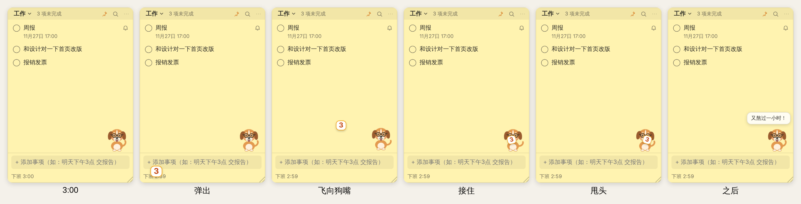

# v1.0.6 改动说明（已审定，已实现）

依据 v1.0.5 实机日志的讨论，四项均按推荐实现。

## 一、日志精简

| 原来 | 现在 |
|---|---|
| 每次按住 / 松开 Ctrl 临时操作，各记一行「窗口样式」 | 不再记。只有穿透功能本身开关、透明度变化，或系统拒绝修改窗口样式时才记 |
| 「系统时间变更」每次都记（一天约 30 次，多为自动对时） | 一小时内最多记一条，并附上「过去一小时内另有 N 次」 |

按 v1.0.5 那天的用法，日志大约从 400 多行降到 60 行以内。

## 二、新增的日志（排查「到点了为什么没提醒」）

喝水 / 起身提醒的每一步都记一行，只记固定的话，不记任何事项内容：

- **开始提醒**：卷起便签 / 冒气泡提醒 / 便签折叠着，只发系统通知 / 到点了，你正在忙，等你停手
- **你点了按钮**：已确认（喝好了 / 活动好了）/ 10 分钟后再提醒
- **被打断**：被事项强提醒打断 / 被正经模式打断 / 狗狗被关掉或收起 / 便签切到了设置等界面。这些都按「10 分钟后再提醒」处理
- **到点了但没提醒**：在正经模式 / 免打扰时段 / 离开电脑超过 5 分钟 / 狗狗被暂时收起。每次到点、每种原因只记一次
- **气泡方式**：两分钟没理会就收起

另外，进入和退出正经模式也各记一行。

例如：`喝水 / 起身提醒（喝水）：到点了，但离开电脑超过 5 分钟，暂不提醒`

## 三、卷起时保持便签的透明度（可选）

设置 → 摸鱼 → 喝水 / 起身提醒，「提醒方式」选「卷起便签」时，下面多一个勾选项「卷起时保持便签的透明度」，默认不勾。

勾上后，卷起期间：
- 按你设的透明度显示（比如 78%），不再变成 100%；
- 不会因为「鼠标离开后自动变淡」而淡到看不清；
- 鼠标穿透照样临时关掉，保证按钮点得到；
- 展开后一切恢复原样。

## 四、狗狗把过去的时间扔掉

- **每过一个整点**：剩余时间从「下班 3:00」变成「2:59」时，旧的小时数字「3」装在白底小牌子里，从倒计时弹出，沿弧线飞进狗嘴；狗狗跳起来接住，甩头把它扔出便签外。整个动画 1.8 秒。
- **狗狗说话**：大约三分之一的次数说「又熬过一小时！」；进入最后一小时一定说「最后一小时，坚持住！」。
- **频率**：设置 → 摸鱼 → 下班倒计时 →「狗狗扔掉过去的时间」，可选每小时（默认）/ 每 30 分钟 / 关闭。选每 30 分钟时，每次扔一个「30 分」小牌子，说「又过了半小时～」。
- **什么时候不扔**：
  - 只在工作日上班时间里扔；
  - 需要同时开着倒计时和狗狗；
  - 狗狗睡觉、正在卷便签、玩球、被拖动、菜单或对话框开着时不扔；
  - 正经模式下不扔；
  - 电脑睡眠或窗口隐藏超过 2 分钟后，不补扔；
  - 系统开了「减少动画」时不放动画，倒计时照常走。

## 五、测试

- **Go 测试**：日志限频；只能记白名单里的固定事件（传入事项内容时不会写进日志）；正经模式开关记日志；保持透明度时仍暂停穿透、不自动变淡、展开后恢复；新设置项的默认值和校验。
- **单元测试**（36 条）：喝水提醒的状态判断（关闭 / 还没到点 / 正经模式 / 免打扰 / 离开电脑 / 该提醒）；整点和半点的判断，包括最后一小时、间隔太久、下班、周末；狗狗说话的规则。
- **端到端测试**（84 条，加网络延迟的回归也全部通过）：
  - 扔时间：每小时扔「3」，最后一小时扔「1」并说话，每 30 分钟扔「30 分」，关闭后不扔；
  - 保持透明度：卷起时透明度保持 60%，同时穿透暂停，展开后恢复。
